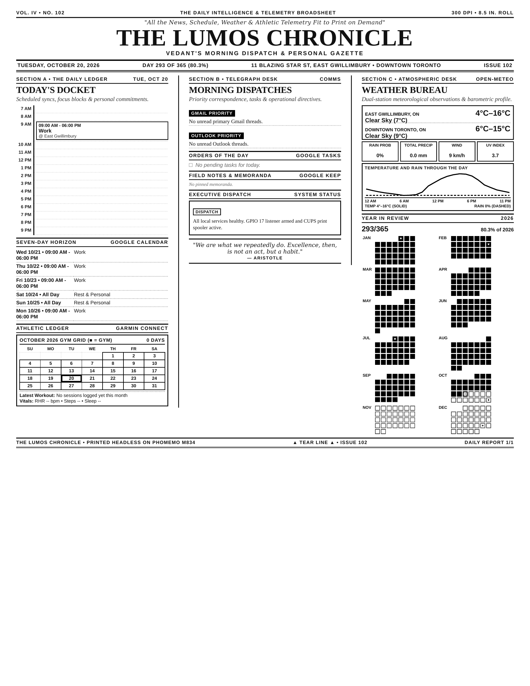

<p align="center">
  
</p>

# 🗞️ Lumos — Automated Daily Broadsheet & Thermal Dispatcher

[](https://www.python.org/downloads/)
[]()
[-black.svg)]()
[-purple.svg)]()
[](LICENSE)

**Lumos** transforms your daily agenda, biometrics, live weather, and fitness splits into an authentic, 1-page vintage morning newspaper — printed automatically every morning on continuous thermal paper via a **Phomemo M834 (300 DPI)** and delivered straight to your mobile chat via **Meta Muse**.

---

## 📸 Daily Broadsheet Preview

<p align="center">
  
</p>

> High-density 300 DPI vector broadsheet (`2026-10-20_Lumos_Digest.pdf`) compiled on a Raspberry Pi 3B for continuous thermal roll printing on the Phomemo M834.

---

## ⚡ Key Highlights

- **Authentic Vintage Newspaper Aesthetic**: Typeset like a classic 19th-century broadsheet (*The Lumos Chronicle*) featuring grand masthead typography, dual-ear weather indicators, double-column editorial rules, and a Latin motto (*Veritas, Constantia, Industria*).
- **Zero Blank Paper Waste**: Calibrated for continuous thermal rolls (`height: auto; max-height: 10.5in;`) — automatically cuts cleanly under the Year-in-Review grid without feeding unnecessary blank paper.
- **Bidirectional Meta Muse Integration**: Triggerable via voice (*"Print my morning brief"*) from anywhere in the world over an encrypted **Noise tunnel**. Returns both a markdown executive summary and **uploads the actual PDF document** directly into your phone's Muse chat.
- **Zero-AI Deterministic Pipelines**: Pulls live data with 0 LLM API token overhead using native Python fetchers:
  - **Dual-Location Weather**: Live Open-Meteo conditions for **East Gwillimbury** and **Downtown Toronto** + an embedded SVG 24-hour temperature and precipitation curve.
  - **Garmin Athletic Ledger**: Headless Garmin Connect synchronization with cached OAuth sessions, 31-day attendance calendar (`■ = Gym Session`), resting heart rate, and step vitals.
  - **MinMax Workout Split**: Automatically reads your workout routine from `minmax_tracker.json` whenever a workout is scheduled on your calendar or tasks.
  - **Ontario Statutory Holiday & Work Scheduler**: Automatically schedules your 9:00 AM – 6:00 PM work block Monday through Friday while observing all 10 Ontario statutory holidays.
  - **Year-in-Review Progress Grid**: 12-month calendar grid with distinct cells visualizing year completion percentage.
- **Desktop Companion (`lumos-ui/`)**: A companion desktop dashboard (React + Vite + Electron) with widgets for Bambu Lab 3D printer telemetry, Google Calendar, system stats, and hotkeys.

---

## 🏛️ System Architecture

```text
               📱 User Mobile Phone
                       │
       "Generate my Lumos report" (Voice / Chat)
                       ▼
            ☁️ Meta Muse Cloud Agent
                       │  - Summarizes GCal, Gmail, Outlook, Tasks, Keep
                       │  - Encrypted Noise Tunnel (hatch.metaaivm.com)
                       ▼
      🍓 Raspberry Pi 3B (leafshin.local)
       ┌─────────────────────────────────────────────────────────────┐
       │  musegadget.service (/run/musegadget/musegadget.sock)       │
       │                                                             │
       │  executor.py                                                │
       │    ├── lumos/fetchers/weather.py (Open-Meteo + 24h curve)   │
       │    ├── lumos/fetchers/garmin.py  (.garth OAuth + ledger)    │
       │    ├── lumos/fetchers/minmax.py  (MinMax split tracker)     │
       │    ├── lumos/fetchers/google.py  (GCal, Tasks, Stat Hols)   │
       │    └── lumos/renderer.py         (WeasyPrint Engine)        │
       │          │                                                  │
       │          ├── Dispatches PDF to CUPS -> Phomemo M834 🖨️     │
       │          └── Streams actual PDF artifact back to Muse 📲    │
       └─────────────────────────────────────────────────────────────┘
```

---

## 📰 Broadsheet Anatomy

| Column | Section | Description |
| :--- | :--- | :--- |
| **Header** | **Grand Masthead** | Broadsheet banner, volume / issue numbers, dual-location ears (East Gwillimbury & Toronto), Latin motto, and daily date badge. |
| **Col 1** | **The Hourly Docket** | 7:00 AM – 9:00 PM timeline mapping focus blocks, scheduled events, and work hours. |
| **Col 1** | **Seven-Day Horizon** | Rolling 7-day forecast of upcoming meetings, appointments, and statutory holidays. |
| **Col 1** | **Athletic Ledger** | Garmin Connect monthly gym attendance grid, recovery vitals (RHR, Steps, Sleep), and targeted MinMax workout split. |
| **Col 2** | **The Telegraph Desk** | Priority dispatches from unread primary Gmail and Outlook threads. |
| **Col 2** | **Orders of the Day** | Google Tasks to-do items and completed tasks ledger. |
| **Col 2** | **Field Memoranda** | Pinned memos and notes from Google Keep. |
| **Col 2** | **Weather Bureau** | High-density 24-hour temperature & precipitation polyline chart rendered as pure inline SVG. |
| **Col 2** | **Year in Review** | 12-month calendar grid (Jan–Dec) displaying days elapsed, remaining days, and percentage of year completed. |

---

## 🚀 Quickstart

### 1. Prerequisites
- **Python**: 3.10 or higher
- **System Dependencies** (for WeasyPrint & Poppler on Raspberry Pi OS / Debian):
  ```bash
  sudo apt update
  sudo apt install -y build-essential python3-dev libpango-1.0-0 libharfbuzz0b \
                      libpangoft2-1.0-0 libffi-dev cups libcups2-dev poppler-utils
  ```

### 2. Installation
```bash
git clone git@github.com:vedantprajapati/Lumos.git ~/lumos
cd ~/lumos
pip install -r requirements.txt
```

### 3. Environment Configuration
Create a `.env` file in the project root:
```env
DEFAULT_USER=vedant
DIGEST_ARCHIVE_ROOT=~/Documents/digest

# Garmin Connect (optional, automatically uses cached tokens in .garth/ if present)
GARMIN_USERNAME=your_email@gmail.com
GARMIN_PASSWORD=your_password

# Printer Configuration
PRINTER_NAME=Phomemo_M834
```

### 4. Generate & Print Manually
```bash
# Render PDF and dispatch to Phomemo M834
python3 -m lumos.renderer

# Render PDF only (skip physical printer queue)
python3 -m lumos.renderer --no-print

# Trigger full RPC executor (renders, prints, and uploads PDF to Muse chat)
python3 executor.py --no-print
```

---

## 🖨️ Hardware & Printer Setup (Phomemo M834)

The **Phomemo M834** connects over USB or Bluetooth to the Raspberry Pi.

```bash
# Verify printer connection
lsusb | grep -i phomemo

# Register raw queue in CUPS
sudo lpadmin -p Phomemo_M834 -E -v usb://Phomemo/M834 -m raw
sudo cupsenable Phomemo_M834
sudo cupsaccept Phomemo_M834

# Verify CUPS recognizes the destination
lpstat -p Phomemo_M834
```

---

## 💻 Lumos UI (Desktop Companion)

Inside [`lumos-ui/`](./lumos-ui/) lives the companion Electron desktop application designed to run persistently in the Windows tray or Start Menu.

<p align="center">
  
</p>

- **Widgets**:
  - `BambuWidget.jsx`: Live telemetry from Bambu Lab 3D printers (nozzle temp, bed temp, print progress).
  - `ClockWidget.jsx`: Minimalist desktop flip-clock.
  - `SystemStatsWidget.jsx`: Real-time CPU, RAM, and storage gauges.
  - `Companion.jsx`: Interactive desktop sprite widget.
- **Run Locally**:
  ```bash
  cd lumos-ui
  npm install
  npm run dev
  ```

---

## 📂 Repository Structure

```text
├── briefing_template.html     # Authentic broadsheet HTML/CSS template (WeasyPrint)
├── minmax_tracker.json        # MinMax workout splits and exercise routines
├── executor.py                # Muse Gadget RPC executor & Noise tunnel PDF messenger
├── lumos/                     # Core backend engine
│   ├── config.py              # Multi-user resolver, paths, and printer configuration
│   ├── renderer.py            # Context aggregator and PDF compilation pipeline
│   └── fetchers/              # Zero-token local Python fetchers
│       ├── weather.py         # Open-Meteo API client & 24-hour SVG curve generator
│       ├── garmin.py          # Garmin Connect client, token caching & attendance grid
│       ├── minmax.py          # Calendar/Task routine detector & split parser
│       ├── google.py          # GCal, Tasks, and Ontario stat holiday calculator
│       └── normalizer.py      # Normalizes external Muse RPC payloads
├── lumos-ui/                  # React + Vite + Electron desktop companion
└── docs/assets/               # Screenshots, diagrams, and print samples
```

---

## 📜 License

Distributed under the [MIT License](LICENSE).
